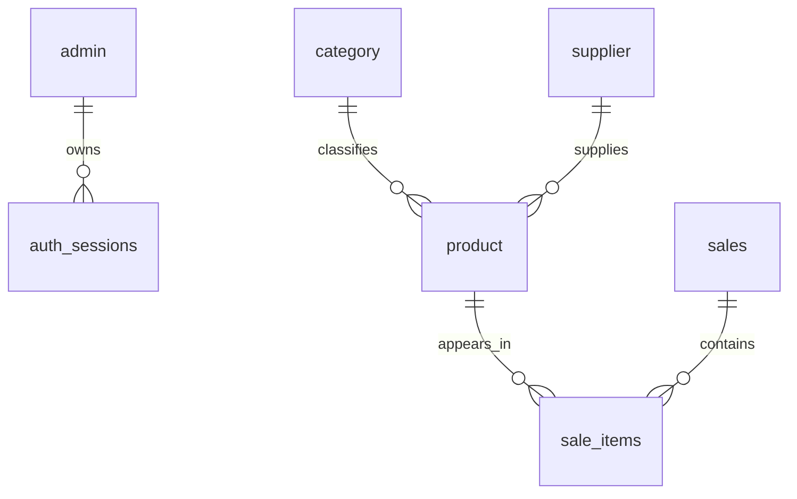

# Database Schema

## Technology

The application supports multiple database backends depending on deployment configuration:

- PostgreSQL via `DATABASE_URL` when the app is deployed to Vercel or another managed Postgres environment.
- MySQL for local and traditional server deployments.
- SQLite as the local fallback when MySQL is unavailable.

Database selection is handled in `database/db.js` at startup. The app creates missing tables and seeds demo data automatically.

## Core tables

### admin

Stores the administrative login credentials used by the application.

| Field | Type | Notes |
|---|---|---|
| id | INTEGER / INT / SERIAL | Primary key |
| username | VARCHAR(50) / TEXT | Unique, not null |
| password | VARCHAR(255) / TEXT | Hashed using scrypt |

### auth_sessions

Tracks active authenticated sessions.

| Field | Type | Notes |
|---|---|---|
| token_hash | CHAR(64) / TEXT | Primary key |
| user_id | INTEGER / INT | Foreign key to admin.id |
| username | VARCHAR(50) / TEXT | Session username |
| expires_at | BIGINT / INTEGER | Unix timestamp in ms |

Indexes:
- `idx_auth_sessions_expires_at` on `expires_at`

### category

Stores product categories.

| Field | Type | Notes |
|---|---|---|
| id | PRIMARY KEY | Auto-incrementing |
| name | VARCHAR(100) / TEXT | Unique, not null |

### supplier

Stores supplier master data.

| Field | Type | Notes |
|---|---|---|
| id | PRIMARY KEY | Auto-incrementing |
| name | VARCHAR(100) / TEXT | Not null |
| company | VARCHAR(100) / TEXT | Not null |
| phone | VARCHAR(50) / TEXT | Not null |
| email | VARCHAR(100) / TEXT | Not null |
| address | TEXT | Not null |

### product

Core inventory table.

| Field | Type | Notes |
|---|---|---|
| id | PRIMARY KEY | Auto-incrementing |
| name | VARCHAR(100) / TEXT | Not null |
| category | VARCHAR(100) / TEXT | Not null |
| supplier | VARCHAR(100) / TEXT | Not null |
| price | DECIMAL(10,2) / REAL | Not null |
| gst | DECIMAL(5,2) / REAL | Not null, default 0 |
| quantity | INTEGER / INT | Inventory on hand |
| minimum | INTEGER / INT | Low-stock threshold |
| maximum | INTEGER / INT | Desired upper bound |
| avg_daily_sales | DECIMAL(10,2) / REAL | Estimated daily sale rate |

Notes:
- `quantity` is decremented when a sale is successfully committed.
- `minimum` and `maximum` are used by the dashboard and restocking recommendation logic.

### sales

Stores a bill / invoice header.

| Field | Type | Notes |
|---|---|---|
| id | PRIMARY KEY | Auto-incrementing |
| invoice_number | VARCHAR(50) / TEXT | Unique, not null |
| customer_name | VARCHAR(100) / TEXT | Optional |
| customer_phone | VARCHAR(50) / TEXT | Optional |
| payment_method | VARCHAR(20) / TEXT | Cash, Card, UPI, Credit |
| subtotal | DECIMAL(10,2) / REAL | Before discount and GST |
| discount | DECIMAL(10,2) / REAL | Not null, default 0 |
| gst | DECIMAL(10,2) / REAL | Not null, default 0 |
| grand_total | DECIMAL(10,2) / REAL | Final total |
| cash_received | DECIMAL(10,2) / REAL | Default 0 |
| balance | DECIMAL(10,2) / REAL | Default 0 |
| created_at | DATETIME / TIMESTAMP | Auto timestamp |

### sale_items

Stores line items attached to each sale.

| Field | Type | Notes |
|---|---|---|
| id | PRIMARY KEY | Auto-incrementing |
| sale_id | INTEGER / INT | FK to sales.id, cascades on delete |
| product_id | INTEGER / INT | Product sold |
| product_name | VARCHAR(100) / TEXT | Snapshot at time of sale |
| price | DECIMAL(10,2) / REAL | Unit price |
| quantity | INTEGER / INT | Quantity sold |
| gst | DECIMAL(10,2) / REAL | Line-item GST |
| discount | DECIMAL(10,2) / REAL | Line-item discount |
| subtotal | DECIMAL(10,2) / REAL | Final line total |

## Relationships



## Inventory transaction flow

1. A product record stores `quantity`, `minimum`, and `maximum`.
2. A billing request validates product existence and available stock.
3. The app checks that requested quantity does not exceed current `product.quantity`.
4. The transaction updates `product.quantity = product.quantity - requested_quantity` for each product in the sale.
5. A row is inserted into `sales` and one or more rows are inserted into `sale_items`.
6. If a sale is deleted, the `sale_items` rows are removed and the stock is restored by reversing the original quantity adjustments.

## Sales and restocking logic

The application uses the following rules:

- Dashboard low-stock alerts trigger when `quantity <= minimum`.
- Restocking predictions evaluate `avg_daily_sales` and recent 30-day sales from `sale_items`.
- The system computes `days_left = quantity / avg_daily_sales` when the sales rate is positive.
- Reorder priority is raised to `Critical`, `Low Stock`, or `Monitor` depending on remaining days and stock threshold.

## Seed data

On first startup, the app inserts default sample data for:
- one admin user (`admin` / `admin123`)
- four categories (`Dairy`, `Grains`, `Beverages`, `Snacks`)
- three suppliers
- six sample products

This is intended to support demos and initial dashboard testing without manual SQL setup.

## Setup and migration notes

The schema is created automatically on startup. There are no separate migration files in this repository; schema creation is managed in `database/db.js`.

To initialize locally:

```bash
npm install
npm start
```

When a managed PostgreSQL connection string is present, the app prefers Postgres. Otherwise it attempts MySQL and then SQLite fallback for local development.
